<div align="center">



<br/>

[](https://prt-bod5.vercel.app/)
[](https://nextjs.org)
[](https://react.dev)
[](https://www.typescriptlang.org)
[](https://tailwindcss.com)
[](https://www.framer.com/motion/)

<br/>

**[✨ About](#-about) · [🚀 Features](#-features) · [🛠 Tech Stack](#-tech-stack) · [🗂 Structure](#-project-structure) · [⚡ Getting Started](#-getting-started) · [☁️ Deploy](#%EF%B8%8F-deploy) · [📬 Contact](#-contact)**


</div>

## ✨ About

A **modern, minimalist personal portfolio** that brings together my work as a web developer, AIML enthusiast, open-source contributor and photographer, all in one fast, animated, responsive site.

> 🌐 **See it live → [prt-bod5.vercel.app](https://prt-bod5.vercel.app/)**

<table>
<tr>
<td width="50%" valign="top">

### 👩‍💻 What you'll find

- A hero section with a quick intro
- About, tech stack and experience
- Featured projects with live links
- Certificates and photography galleries
- Blog links and a contact section

</td>
<td width="50%" valign="top">

### 🎯 Built to feel

- **Fast**: Next.js App Router + Turbopack in dev
- **Alive**: particles, motion and Lottie animations
- **Clean**: Tailwind-driven, minimal layout
- **Comfortable**: dark / light theme support

</td>
</tr>
</table>


## 🚀 Features

| | Feature | Details |
|---|---|---|
| 🎬 | **Smooth animations** | Page and element transitions powered by Framer Motion |
| ✨ | **Particle backgrounds** | Interactive effects using tsParticles |
| 🌗 | **Theme switching** | Dark / light mode via `next-themes` |
| 🧩 | **Lottie illustrations** | Lightweight vector animations with `react-lottie` |
| 📜 | **Certificates page** | Dedicated route to showcase achievements |
| 📸 | **Photography page** | A gallery for my photography work |
| 📝 | **Blog link-out** | Writing shared on Medium |
| 🔐 | **Admin route** | Protected admin area guarded by middleware |
| 📋 | **One-click email copy** | Copy my address straight from the contact section |

## 🛠 Tech Stack

<div align="center">

</div>

<br/>

| Layer | Tools |
|---|---|
| **Framework** | Next.js 15 (App Router), React 19 |
| **Language** | TypeScript |
| **Styling** | Tailwind CSS, `tailwindcss-animate`, `tailwind-merge`, `clsx` |
| **Motion & visuals** | Framer Motion, tsParticles, react-lottie |
| **Icons** | Tabler Icons, React Icons |
| **Theming** | next-themes |
| **Tooling** | ESLint 9, Turbopack, PostCSS |
| **Hosting** | Vercel |

## 🗂 Project Structure

```bash
prt/
├── app/                  # App Router: pages, layouts and routes
├── components/           # Reusable UI components
├── data/                 # Content and configuration data
├── lib/                  # Helpers and utilities
├── public/               # Static assets (images, SVGs, animations)
├── assets/               # README visuals (animated SVGs)
├── middleware.ts         # Request middleware
├── next.config.js        # Next.js configuration
├── tailwind.config.ts    # Tailwind configuration
├── tsconfig.json         # TypeScript configuration
├── eslint.config.mjs     # Lint rules
├── .env.example          # Environment variable template
└── package.json
```

## ⚡ Getting Started

**Prerequisites:** [Node.js](https://nodejs.org) 18.18+ and npm.

```bash
# 1. Clone the repository
git clone https://github.com/Anjaliavv51/prt.git
cd prt

# 2. Install dependencies
npm install

# 3. Set up environment variables
cp .env.example .env.local
# then fill in the values inside .env.local

# 4. Start the dev server
npm run dev
```

Open **http://localhost:3000** and start editing `app/page.tsx`, the page hot-reloads as you save.

### 📜 Available scripts

| Command | What it does |
|---|---|
| `npm run dev` | Start the dev server (with Turbopack) |
| `npm run build` | Create an optimized production build |
| `npm run start` | Serve the production build |
| `npm run lint` | Run ESLint |

## ☁️ Deploy

The easiest way to ship this is on **[Vercel](https://vercel.com/new)**:

1. Push the repo to GitHub.
2. Import it in Vercel.
3. Add the variables from `.env.example` in **Project Settings → Environment Variables**.
4. Deploy. Every push to `main` goes live automatically.

## 🤝 Featured Projects

A few things I've built (more on the [live site](https://prt-bod5.vercel.app/#projects)):

| Project | What it is |
|---|---|
| [**Retro**](https://github.com/Anjaliavv51/Retro) | A vintage-themed open-source web app and collaborative platform |
| [**Touch-No-Fire-Game**](https://github.com/Anjaliavv51/Touch-No-Fire-Game) | A browser mini-game: dodge obstacles while the fire keeps multiplying |
| [**Heart Disease Prediction**](https://github.com/Anjaliavv51/Heart_disease) | An ML tool that predicts heart disease risk with ensemble algorithms |
| [**Animated iPhone 3D Website**](https://github.com/Anjaliavv51/3d-portfolio) | An iPhone 15 Pro site recreated with GSAP and Three.js |

## 📬 Contact

Have an idea, a collaboration, or just want to say hi? Let's talk.

<div align="center">

[](mailto:plpanjali05@gmail.com)
[](https://www.linkedin.com/in/pamidi-lakshmi-pavananjali-912a55257/)
[](https://github.com/Anjaliavv51)
[](https://medium.com/@plpanjali05)
[](https://www.instagram.com/nameits.any)
[](https://drive.google.com/file/d/1zY5hGuvC-44b8hQJEn3KXADNNnXyZtI2/view?usp=sharing)

<br/>

⭐ If you like this portfolio, a star on the repo means a lot!

<br/>


</div>
